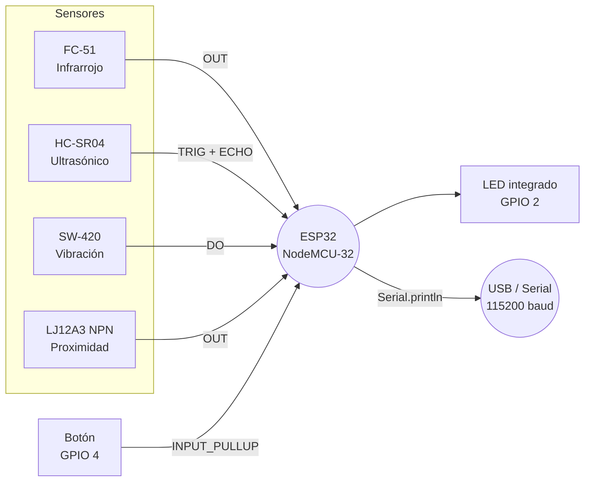

# Sistema de Alarma Multi-Sensor (NodeMCU-32)


## 1. Descripción del proyecto

`SampleAlarm` es un firmware para **ESP32 (NodeMCU-32)** que implementa
un sistema de alarma básico basado en la lectura simultánea de cuatro
sensores:

| Sensor | Detecta | Condición de disparo |
|---|---|---|
| Infrarrojo (FC-51 / similar) | Presencia / cruce de haz | `LOW` en `OUT` |
| Ultrasónico (HC-SR04) | Distancia < 20 cm | `distance < 20` |
| Vibración (SW-420) | Golpe / impacto | `HIGH` en `DO` |
| Proximidad inductivo NPN | Metal a < 4 mm | `LOW` en `OUT` |

### Estados del sistema

- **Desarmado:** LED integrado apagado, sensores no leen.
- **Armado (monitoreando):** LED encendido fijo.
- **Alarma disparada:** LED parpadea rápido y se imprime la causa por
  `Serial`. La alarma se **mantiene activa** aunque el sensor deje de
  detectar, hasta que se vuelva a presionar el botón (lo cual la
  desarma y reinicia el flag `alarmTriggered`).

### Control

- **Botón físico en GPIO 4** (`INPUT_PULLUP`): cada pulsación alterna
  entre `ARMADO` ↔ `DESARMADO`. Rebote mitigado con `delay(250)` y
  espera activa hasta que se suelte.

---

## 2. Materiales utilizados

### 2.1 Lista de componentes

| # | Componente | Cant. | Notas |
|---|---|---|---|
| 1 | NodeMCU-32 (ESP32-WROOM-32 DevKit V1) | 1 | MCU principal, 3.3 V |
| 2 | Sensor infrarrojo reflexivo (FC-51 / KY-032) | 1 | Salida digital |
| 3 | Sensor ultrasónico HC-SR04 | 1 | TRIG / ECHO, 5 V tolerante con divisor |
| 4 | Sensor de vibración SW-420 | 1 | Salida digital, requiere pull-up |
| 5 | Sensor de proximidad inductivo NPN (LJ12A3-4-Z/BX) | 1 | 3 hilos: marrón VCC, azul GND, negro OUT |
| 6 | Botón pulsador (push button) | 1 | Para armar/desarmar |
| 7 | Resistencias 1 kΩ y 2 kΩ | 1 c/u | Divisor de voltaje para ECHO del HC-SR04 |
| 8 | Cables dupont / jumpers | varios | Conexión protoboard |
| 9 | Protoboard | 1 | Ensamble |
| 10 | Cable USB micro-B (datos) | 1 | Para flasheo y serial |

### 2.2 Diagrama de la placa (NodeMCU-32)

El firmware usa estos pines del **ESP32-WROOM-32**:

| GPIO | Función en firmware | Dirección | Notas |
|---|---|---|---|
| `GPIO 2` | LED integrado (azul) | `OUTPUT` | LED on-board, active-high |
| `GPIO 4` | Botón armar/desarmar | `INPUT_PULLUP` | Pin del pulsador a GND |
| `GPIO 12` | HC-SR04 `TRIG` | `OUTPUT` | — |
| `GPIO 14` | HC-SR04 `ECHO` | `INPUT` | ⚠️ Voltaje del sensor es 5 V → divisor 1kΩ/2kΩ |
| `GPIO 13` | Sensor IR `OUT` | `INPUT` | FC-51 ya trae su comparador |
| `GPIO 27` | Sensor inductivo `OUT` | `INPUT_PULLUP` | Sensor NPN → drenar a GND |
| `GPIO 34` | SW-420 `DO` | `INPUT` | ⚠️ GPIO 34 **solo entrada**, sin pull-up interno → requiere pull-up externo de 10 kΩ a 3V3 |

> El GPIO 34 es ADC-only y **no tiene resistencia de pull-up interna**;
> el SW-420 trae comparador open-collector, por lo que **necesitas
> soldar una pull-up de 10 kΩ** entre su pin `DO` y `3V3`, o el
> comportamiento será errático.

---

## 3. Diagrama de conexión de los sensores

### 3.1 Tabla de cableado

| Sensor | Pin del sensor | Pin ESP32 (GPIO) | Cable → |
|---|---|---|---|
| **FC-51 IR** | `VCC` | `3V3` | Rojo |
| | `GND` | `GND` | Negro |
| | `OUT` | `GPIO 13` | Amarillo |
| **HC-SR04** | `VCC` | `5V` (VIN) | Rojo |
| | `GND` | `GND` | Negro |
| | `TRIG` | `GPIO 12` | Verde |
| | `ECHO` | `GPIO 14` *(vía divisor)* | Azul |
| **SW-420** | `VCC` | `3V3` | Rojo |
| | `GND` | `GND` | Negro |
| | `DO` | `GPIO 34` | Blanco *(+ pull-up 10 kΩ a 3V3)* |
| **Inductivo NPN** | Marrón (`VCC`) | `5V` o `3V3` *(ver datasheet)* | Marrón |
| | Azul (`GND`) | `GND` | Azul |
| | Negro (`OUT`) | `GPIO 27` | Negro |
| **Botón** | Terminal A | `GPIO 4` | — |
| | Terminal B | `GND` | — |

### 3.2 Divisor de voltaje para ECHO del HC-SR04

El HC-SR04 emite 5 V en `ECHO`, pero los pines del ESP32 son **3.3 V
tolerant**. Usa este divisor entre `ECHO` y `GPIO 14`:

```
ECHO ──[ 1 kΩ ]──┬── GPIO 14
                 │
                 └──[ 2 kΩ ]── GND
```

Relación: `Vout = 5 V × 2 / (1 + 2) ≈ 3.33 V` → seguro.

### 3.3 Diagrama de bloques



---

## 4. Compilar, subir y monitorear

El proyecto es un único archivo `SampleAlarm.ino`. Hay tres caminos
habituales; escoge el que tengas instalado.

### 4.1 Con Arduino CLI (recomendado para CLI puro)

```bash
# 1) Instalar el núcleo ESP32 (solo la primera vez)
arduino-cli core update-index
arduino-cli core install esp32:esp32

# 2) Compilar
arduino-cli compile \
  --fqbn esp32:esp32:esp32 SampleAlarm

# 3) Subir al dispositivo (ajusta el puerto)
arduino-cli upload \
  -p /dev/ttyUSB0 \
  --fqbn esp32:esp32:esp32 \
  --upload-property upload.speed=115200 SampleAlarm

# 4) Monitorear el puerto serial
arduino-cli monitor \
  -p /dev/ttyUSB0 \
  -c baudrate=115200
```

### 4.2 Con PlatformIO

Crea un `platformio.ini` mínimo junto al `.ino`:

```ini
[env:nodemcu-32s]
platform = espressif32
board = nodemcu-32s
framework = arduino
monitor_speed = 115200
```

Luego:

```bash
# Compilar
pio run

# Compilar + subir + abrir monitor serie
pio run -t upload -t monitor

# Solo monitor serie (después de subir)
pio device monitor -b 115200
```

### 4.3 Con Arduino IDE

1. `File → Open…` → seleccionar `SampleAlarm.ino`.
2. `Tools → Board → ESP32 Dev Module` (o "NodeMCU-32s").
3. `Tools → Upload Speed → 921600`.
4. `Tools → Port → /dev/ttyUSB0` (Linux) o `COMx` (Windows).
5. `Sketch → Upload` (Ctrl+U).
6. `Tools → Serial Monitor` → baud **115200**, `Newline`.

---

## 5. Monitorear mensajes de la consola

El firmware imprime a `Serial` a **115200 baud**. Cuando arranca verás:

```
=========================================
--- Sistema de alarma inicializado ---
=========================================
```

Tras pulsar el botón:

```
-----------------------------------------
>>> Botón presionado. Estado del sistema: ARMADO
-----------------------------------------
```

Y al disparar la alarma (ejemplo con sensor IR):

```
>>> Alarma activada por el sensor infrarrojo.
```

Comando genérico con `miniterm` o `screen` (útil en Linux sin IDE):

```bash
# miniterm (pyserial)
miniterm /dev/ttyUSB0 115200

# screen
screen /dev/ttyUSB0 115200
# para salir: Ctrl-A, k

# Con cu
cu -l /dev/ttyUSB0 -s 115200
```

> 💡 Si no ves nada, prueba `Ctrl+M` (CR) en el monitor serie, o revisa
> que el puerto correcto esté seleccionado y que ningún otro proceso
> (p. ej. el IDE de Arduino) lo tenga abierto.

---

## 6. Otros comandos útiles

### 6.1 Listar dispositivos / puertos serial

```bash
# Linux
ls -l /dev/ttyUSB* /dev/ttyACM*
dmesg | grep -i usb | tail -n 10        # ver último dispositivo conectado

# macOS
ls /dev/cu.usbserial* /dev/cu.SLAB*
ioreg -p IOUSB -l | grep -i 'usb serial'

# Windows (PowerShell)
[System.IO.Ports.SerialPort]::GetPortNames()

# Con Arduino CLI
arduino-cli board list
arduino-cli board list --json          # formato JSON, fácil de filtrar

# Con PlatformIO
pio device list
```

### 6.2 Identificar el chip y subir firmware crudo con `esptool`

Si necesitas flashear a bajo nivel (recuperar un ESP32 brickeado, etc.):

```bash
# Instalar
pip install esptool

# Detectar chip
esptool.py --chip esp32 --port /dev/ttyUSB0 chip_id

# Borrar flash completa
esptool.py --chip esp32 --port /dev/ttyUSB0 erase_flash

# Subir un .bin (Arduino CLI genera uno en ./build)
esptool.py --chip esp32 \
  --port /dev/ttyUSB0 \
  --baud 460800 \
  write_flash -z 0x1000 ./build/SampleAlarm.ino.bin
```

### 6.3 Permisos en Linux (sin usar sudo cada vez)

```bash
# Tu usuario al grupo dialout (logout/login después)
sudo usermod -aG dialout $USER

# O regla udev específica para chips CH340/CP2102 (la mayoría de NodeMCU)
# (los nombres exactos dependen del convertidor USB-serial de tu placa)
lsmod | grep -E 'ch34|cp210|ftdi'
```

### 6.4 Monitor con `idf.py` (si usas ESP-IDF)

```bash
idf.py -p /dev/ttyUSB0 monitor
# Para salir: Ctrl-]
```

---

## 7. Solución de problemas

| Síntoma | Causa probable | Acción |
|---|---|---|
| Puerto no aparece | Driver USB-serial faltante | Instalar CH340 / CP210x según placa |
| `A fatal error occurred: Failed to connect` | ESP32 en modo bootloader | Mantén pulsado **BOOT**, pulsa **EN**, suelta **BOOT**, reintenta |
| `Serial` vacío tras subir | Baud incorrecto | Verifica **115200** en el monitor |
| Sensor IR no dispara | Polaridad del `OUT` invertida | Algunos módulos sacan `LOW` sin objeto y `HIGH` con objeto — invierte la lógica o cambia el módulo |
| HC-SR04 siempre devuelve 999 | Cableado / divisor mal | Verifica `TRIG` 5V → GPIO12 (no necesita divisor), y `ECHO` 5V → divisor → GPIO14 |
| SW-420 no responde | Falta pull-up en GPIO 34 | Agrega 10 kΩ entre `DO` y `3V3` |
| LED no enciende | GPIO 2 invertido en algunas placas | Prueba `digitalWrite(PIN_LED, LOW)` cuando debería estar encendido y viceversa |

---

## 8. Licencia y créditos

Demo educativo. Sensores y placa son productos de sus respectivos
fabricantes (Espressif, SparkFun, Elegoo, etc.). Ajusta la licencia
según el uso que darás al proyecto.